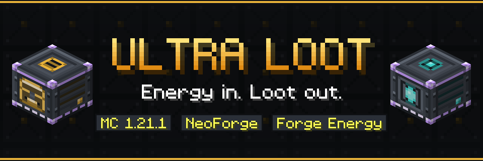

**Tech machines that turn energy into loot.** Pick a loot table, plug in Forge Energy, and Ultra Loot fills your chests: dungeon chests, trial chamber vaults, fishing, archaeology, piglin bartering, and the drops of any mob you put on a card. **No mob is ever spawned, nothing is lost, nothing is duplicated.**

Minecraft **1.21.1** · NeoForge **21.1.267+** · needed on client **and** server · needs any mod that produces FE.

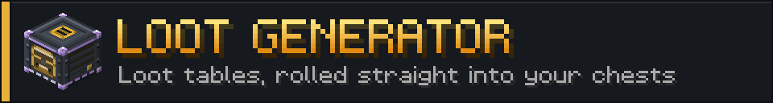

Runs FE through a **loot profile** and puts the result straight into the chests and barrels around it. It plans every delivery first and only commits when all of it fits, so it never drops or voids items: if your storage is full, it waits.

- **66 profiles**: every vanilla chest table, fishing, archaeology, piglin bartering, trial chambers and five Ultra Loot tables. Chest tables from other mods are found automatically.
- Up to **4 rolls** per operation and **16 blocks** of range at Tier IV.

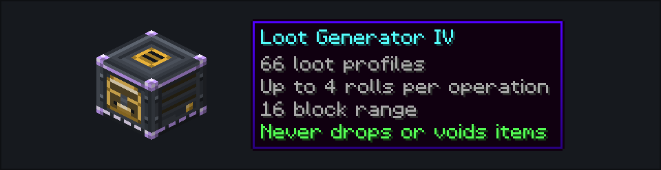

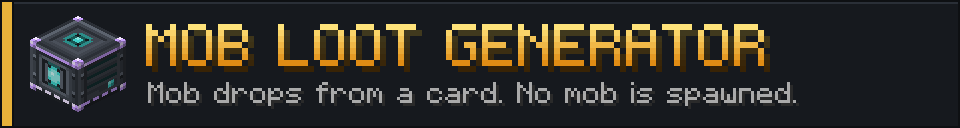

Right-click a mob with a **Blank Mob Card** to copy it (the mob is unharmed). Put the card in the machine and it simulates kills of that mob, paid with **FE and experience**. Drops go to a 27-slot output you can pipe away.

- Mobs are sorted into **reward tiers I–III**: a zombie is cheap, a witch or an evoker costs much more.
- Works with other mods: the mob's own loot table is used, and datapacks can add or replace drops.

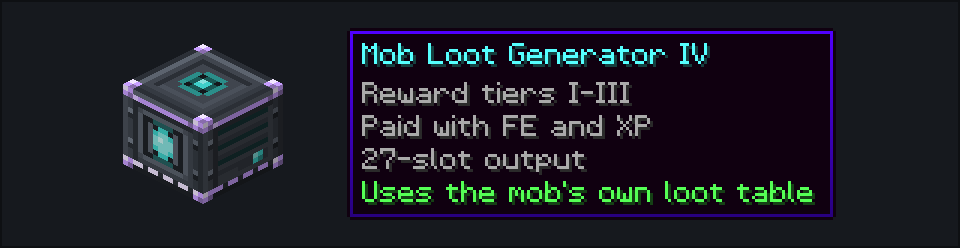

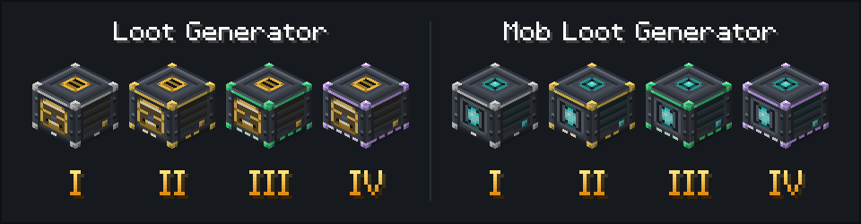

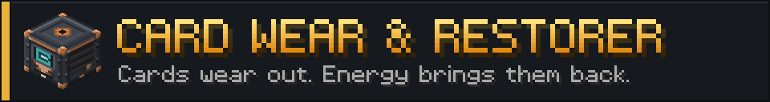

Card data **wears out**. A card is perfect for **2,048 kills**, then it slowly decays: more Rotten Flesh, higher FE cost. A fully corrupted card still works but only gives Rotten Flesh. It never breaks: repair it with energy in the **Card Restorer** and it is as good as new.

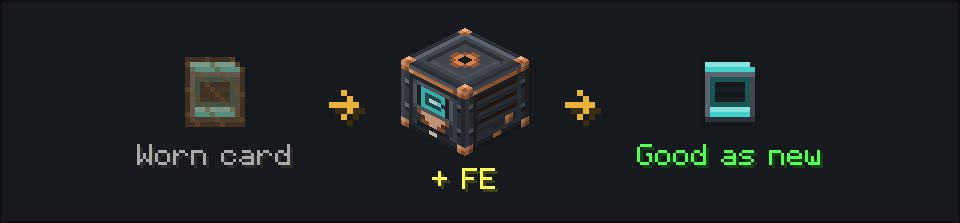

**Speed, Quantity, Range, Efficiency and Loot**, each in levels I–III, one per category. One clear energy formula behind all of them, with a floor so stacks never become free.

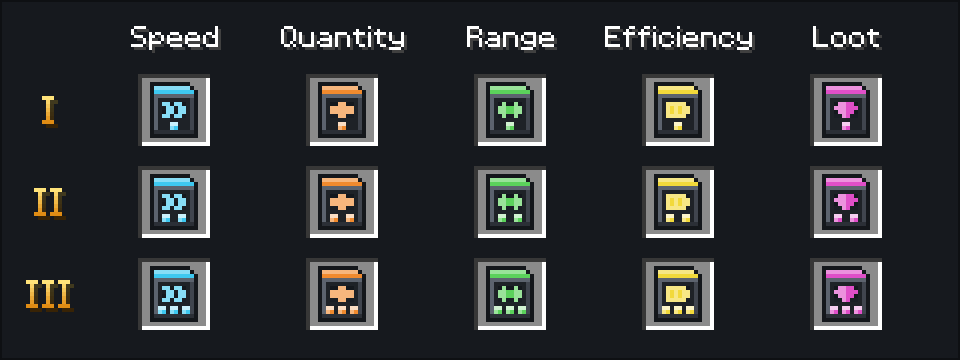

- **Ultra Loot Guide**: every player gets an in-game book on first join. 13 chapters with real crafting grids, item icons and troubleshooting.
- **Status line with colour and shape**: cyan = working, gray = idle, amber "!" = waiting for something, red "x" = needs you. Hover it for the reason.
- **Six-face side configuration** for energy, item targets, XP input and item output.
- **Dynamic energy buffer**: the machine always has room for one operation, whatever cards you add.
- **Experience input**: Bottles o' Enchanting, the Experience Capsule, any `c:experience` fluid, nearby XP orbs.
- **Data driven**: profiles, mob costs, filters and blacklists are datapack content; timings and costs are in the server config.

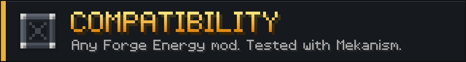

Tested with **Mekanism 10.7.19**: universal cables power the machines, and logistical transporters pull items out and push Mob Cards in. Any mod that provides FE and the standard item capability should work.

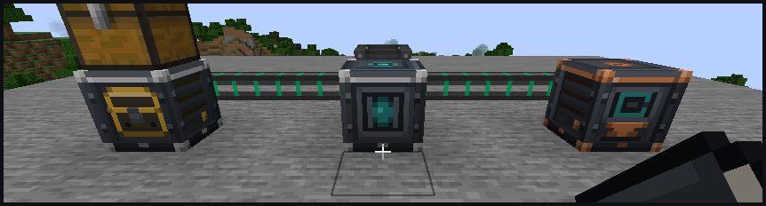

**Beta (0.x).** The balance numbers are first-pass values and may change. Please report bugs and balance feedback on the [issue tracker](https://github.com/CAKeysama/Ultra-loot/issues). Source, docs and changelog: [github.com/CAKeysama/Ultra-loot](https://github.com/CAKeysama/Ultra-loot)

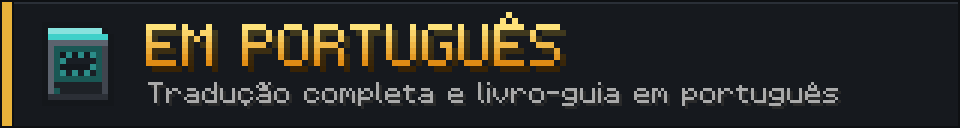

Máquinas tecnológicas que transformam energia em loot. O **Gerador de Loot** sorteia tabelas de loot (baús, pesca, arqueologia, escambo com piglins) e entrega direto nos seus baús. O **Gerador de Loot de Mobs** simula abates a partir de um **Cartão de Mob**, pagando com FE e experiência, sem spawnar nada. Os cartões se desgastam com o uso e são consertados no **Restaurador de Cartões**. O mod é todo traduzido e inclui um livro-guia completo em português.
